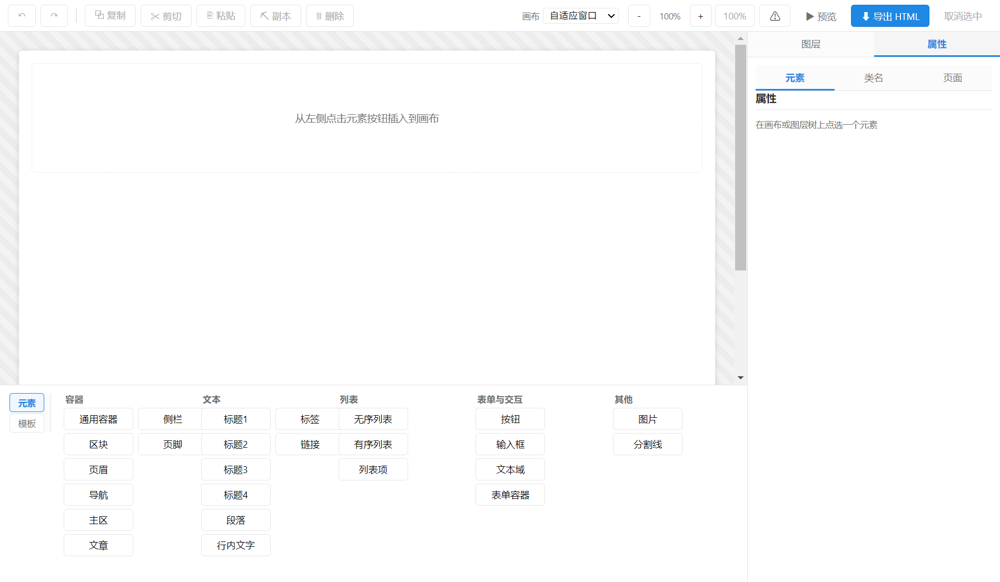
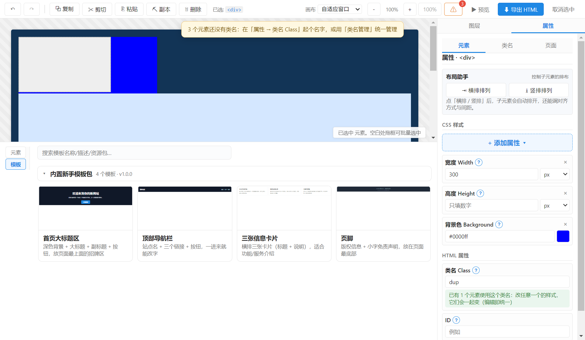

# BlockCanvas · 积木画布

<p align="center">
  
</p>

<h1 align="center">BlockCanvas · 积木画布</h1>

<p align="center">
  <strong>让完全不懂代码的人，也能做出专业网页的桌面可视化编辑器</strong><br/>
  拖拖拽拽画界面 · 内置模板 · 后期接入 Scratch 式积木编程<br/>
  最终导出干净、可读、手写级的 HTML / CSS / JS
</p>

<p align="center">
  <a href="#"></a>
  
  
  
</p>

---

## 📚 三份文档 · 先看这里

本项目的文档分三份，各司其职（**软件内「帮助中心」也能直接看这三份**）：

| 文档 | 内容 | 什么时候看 |
|---|---|---|
| **项目介绍**（就是本文） | 这是什么、怎么装、怎么编译、代码怎么改 | 第一次接触 / 想了解项目全貌 |
| [**使用手册**](docs/使用手册.md) | 每个面板、每个按钮、每种交互、每条快捷键 | **不会用某个功能时**（最常翻的一本） |
| [**开发历程**](docs/开发历程.md) | 按时间倒序的迭代记录（问题 → 根因 → 方案） | 想知道"为什么当初这样做" |

> 不会用软件 → 看《使用手册》；想改代码 / 写插件 → 看本文的「AI 协作导航」+《扩展规范》。

---

## 📖 项目简介

BlockCanvas（积木画布）是一个**可视化静态网页构建工具（WYSIWYG）**。核心目标是：**给零基础用户一个「可视化网页工厂」**，让你像用画图软件一样拖出界面，产物必须是手写级的干净代码，而不是一堆 `<div>` 山。

- 🖱️ 用鼠标拖拖拽拽就能搭出网页界面
- 🧩 内置大量模板资源包，一键插入
- 🧱 后期用 Scratch 式积木编程添加交互
- 📤 导出纯净、语义化、可读的 HTML + CSS（后续 +JS）
- 💾 **纯便携设计**：所有工程、快照、配置均存储在 `data/` 目录，不写系统 AppData 和注册表
- 🔄 **自动更新系统**：启动时静默检测 GitHub Releases 最新版本，有更新弹窗提示，设置页可手动检测；更新时只替换程序本体，永久保留 `data/` 下的所有用户数据

> 说人话：不懂代码，也能做出专业网页。

## ✨ 功能特性

- **所见即所得画布**：流式布局为主，元素可切换 `position`（static/relative/absolute/fixed/sticky），贴合真实网页行为
- **语义化元素系统**：`div / header / nav / section / main / article / aside / footer / 标题 / 段落 / 按钮 / 输入框 / 图片…`，导出不堆 `div`
- **属性面板**：盒模型（4 值分开填写）/ 定位 / 颜色与渐变 / 字体 / 边框 / 阴影 / 快捷助手（Flex · Grid · 文字渐变）实时预览
- **滚轮调值**：任意数值框点一下进入输入状态，滚动滚轮即增减（上滚增大 / 下滚减小），按住 `Shift` 一次调 10；停手自动提交，一次聚焦 = 一条撤销
- **设计变量（Token）**：把主色 / 圆角 / 间距 / 字号 / 阴影定义成 `--bc-*` 变量，元素里引用 `var(--bc-primary)`，**改一处全站跟着变**；导出时写入 `:root`，脱离本软件同样生效
- **导出前体检**：导出 / 预览前自动扫描并拦截严重问题（写了 `:hover` 却没类名、ID 重复、同名样式不统一…），按严重度列出并支持一键修复。**表格默认不参与体检**（一格一个 `td/th`，正常做表格既不起类名也不写 CSS，参与只会刷屏"未命名元素"），需要时在表格编辑器右侧面板打开「让这张表参与导出前体检」；向导头部会写明"已跳过 N 张表格"，免得以为是漏检
- **渐变体系**：PowerPoint 风格可视化渐变编辑器（角度方向盘 + 色标 + 26 款预制配色），支持无损导入模板里手写的 `linear-gradient(...)`
- **快捷助手**：把「多条 CSS 属性配合才能做出的效果」打包成一句话 —— Flex / Grid 布局、文字渐变；生成的属性可一键从下方 CSS 列表隐藏（全局统一开关，见「设置 → 编辑器与画布」）
- **图层管理器**：树状 DOM，拖拽改层级 / 重命名 / 显隐 / 锁定
- **样式系统**：样式自动抽类（`.bc-s-*`）复用，同名冲突统一，导出干净 CSS
- **模板资源库**：内置 14 个完整网页模板（品牌首页 / 营销转化 / 信息内容 / 基础组件），按分类展示，一键插入
- **扩展系统**：插件 + 资源包，统一放在程序目录 `extensions/`，支持导入 / 导出 / 启停
- **Undo / Redo**：全局可序列化单一数据源，所有操作可撤销/恢复
- **伪类交互编辑**：支持 `:hover` / `:active` / `:focus` / `:link` 状态，每个伪类内置多款预制动效（上浮 / 放大 / 发光 / 下沉 / 外圈光晕…），套用后可用滑块微调位移、缩放、旋转、阴影与过渡时长
- **工具栏自由池 + 二级工具组**：一条工具栏 = 主区 + 右端固定区（两区都能横向滚动，**竖向滚轮即可左右滚，不必按 Shift**）+「⋯更多」收纳；每个按钮的停靠区与顺序都可在「设置 → 工具栏管理」拖拽调整。多个按钮还能打包成**工具组**（鼠标悬浮即展开组内工具），出厂已把「复制/剪切/粘贴」折成「剪贴板」、「电脑/平板/手机」折成「设备」（**电脑 = 固定 1920px 画布、自适应 = 铺满编辑区**，两个按钮各管各的）。**「⋯更多」的左边是一个常驻「任务」按钮**：鼠标浮上去就能看到当前正在跑的下载 / 更新任务（进度、已下载多少 MB、走的哪个镜像），并可直接 **停止 / 继续 / 取消 / 打开 zip 所在文件夹** —— 任务是**主进程里的后台任务**，离开这一页、切到别的视图、甚至重启软件都还在。**「⋯更多」本身也是一个工具组**：**插件注册的工具栏按钮只能进「⋯更多」**（插件不能把自己直接塞上工具栏），想放到主区/右区，用「设置 → 工具栏管理」里每个区域右端的「**＋ 插入按钮**」（可搜索、内联选择器，点一下即插到该区域末尾）
- **插件 API**：插件入口 `index.js` 由 `new Function('Bc', source)(Bc)` 求值，宿主对象提供 `registerCss / registerCommand / registerElement / registerProperty / registerExportHook` —— 可加样式、加工具栏命令、加元素类型、加属性面板字段、挂钩导出流程
- **画布直接改（按住 Alt）**：平时画布只负责选中/预览，**按住 `Alt`** 才进入"可直接编辑"状态，避免误触 —— 指针贴到元素**边缘**拖动即**改大小**（贴左/上边时对侧边固定，方向不反；**行内元素不参与**）、按住**文字**中间左右拖即**改字号**（拖动时鼠标隐藏、有实时数值）、按住**其它元素**中间拖动即**移动位置**；拖动全程有**实时数值气泡**与命中边提示，且**一次拖动 = 一条撤销**。移动/缩放有**"墙"**：**只有 `fixed` 受视口限制**（只能在**画布**里，相当于浏览器视口），其它元素**横向**不出父容器、**纵向可一直往下拖把画布撑长**；撞到边界会**橙色闪一下整条边界线**（说明是限制不是 BUG）。**`Alt + 滚轮`** 以鼠标位置为锚点**精准缩放**（分度 4%/格）
- **右键文字菜单**（不用 Alt、块级容器不弹）：可调**字号 / 字重 / 颜色 / 下划线 / 删除线 / 斜体**，菜单里显示的就是**这段文字自己的当前值**。规则统一：右键整个元素、或编辑态里**选中整段** → 写**整段 CSS**（与右侧属性面板**完全互通**）；只选中**一部分** → 只给这一段套**内联 `<span style>`**（不用选择器，优先级高于整段 CSS，两边永不打架）
- **就地编辑文案**：双击文字元素弹出**自动撑高的多行编辑框**（长文本完整可见）；**点别处 / `Esc` 都保存**、`Enter` 换行；换行导出时**自动生成 `<br>`**，编辑框右上角有「**显示 `<br>`**」开关可淡灰标出换行位置（只是显示，不影响内容）
- **框选视口外**：空白处拖框时，把鼠标移到画布上/下（或左/右）边缘，画布会**自动滚动**；选框锚定在**画布内容**上，滚出去的部分也能框进来，不会因滚动而错位
- **模板元素改得动**：模板插入的元素（如卡片里的标题）样式原本由**父容器的子元素样式规则**提供、特异性更高，导致"选中了改样式没反应"；现在编辑时会自动把同名声明从容器规则里剔除，子元素自己的样式随即生效（导出同样正确）
- **统一按钮语言 + 帮助气泡**：所有面板按钮走同一套基线（`.btn-primary / secondary / danger / mini / ghost`：高度、内边距、圆角、悬浮、禁用态一致）——以前 `.btn-primary` 只在工具栏作用域里定义过，别处都是系统默认长相；`?` 帮助气泡改为**悬停 0.5 秒**弹出、带退场动画，并去掉了原生 `title` 那层重复的长方形提示
- **细滚动条 + 不再抖动**：全站滚动条统一收窄为细身样式；滚动容器常驻滚动条槽位（`scrollbar-gutter: stable`），滚动条出现/消失不再把旁边内容推来挤去
- **表格编辑器（专用页面）**：选中表格后一键进入独立编辑页。**能用鼠标拖的绝不做按钮墙** —— 行与行、列与列之间是「插入轨」，悬浮浮出 `＋`（整条轨道都是热区，不用瞄准）：点一下插 1 个，**按住往右/往下拖可一次插 N 个**（实时高亮预览 + 计数气泡，Esc 取消）；格子上按住拖动可**框选矩形区域**（**Ctrl/⌘+点** 加选、**Shift+点** 从起点拉伸），顶部的选区操作条随选区亮起：合并 / 拆分 / 设为表头 / 删行 / 删列；**Del** 只清空格子文字，不动结构；**双击格子就能就地改文字**（回车确认 / Esc 取消）。`colspan`/`rowspan`/`scope` 全支持，表格专用 CSS（`border-collapse`/`table-layout`/`border-spacing`/`caption-side`/垂直对齐…）单独适配；每个字段都写了"人话解释"并配 `?` 帮助。右侧面板另有「让这张表参与导出前体检」开关（默认关闭）；内置 6 套样式预设 + 4 个结构模板（**只在表格编辑器里**，元素面板不再塞这些按钮）。**Ctrl+A** 全选整张表（所有单元格）、**Ctrl+C** 复制选区（Tab 分隔，可直接粘进 Excel / WPS）、**Ctrl+Shift+C** 复制整张表 HTML
- **表格编辑器「所见即所得」**：右侧面板就是三个清晰区块 ——「**选择器与标识**」（表名 + 一键自动命名 + 体检开关）、「**单元格设置**」（选中格/多格；顶部是与真实单元格一致的实时预览，下面按 **颜色 / 数值 / 文本** 分小节，底部「应用到全部单元格」）、「**表格设置**」（整表样式 + 大致效果预览）、「**一键预设样式**」（每套预设画一张缩略小表）。改任何一项**左边表格与右侧预览同时实时变**；数值输入统一「数字 + 单位」控件（**点输入框滚轮可调、按住 Shift 一次调 10**，单位默认 px）；颜色点色块开调色盘。所有连续操作都**合并成一条撤销记录**，一次 `Ctrl+Z` 回到操作前；按 `Esc` 或点结构网格空白处可取消选中。**「自动取名」保证每个内部元素都拿到只属于它自己的选择器**：文档里有多张表时，表名重名会自动改用 `-2 / -3` 后缀，并把上一轮生成的老选择器一并改写，不会出现"两张表选择器一样、改一张另一张跟着变"；预设的斑马纹也不会覆盖你手改过的格子底色。编辑器里看到的表格会真的套上表格的「子元素样式」（`.data-table th { … }` 那类），因此**和画布上长得一样**
- **表格的命名与体检**：整张表只需要最外层 `<table>` 一个类名/ID；「**⚡ 自动取名表格内的元素**」一键给内部元素生成精准关系选择器（如 `.data-table > tbody > tr:nth-child(2) > td:nth-child(1)`），格子一个类名都不用起。表格**默认参与**导出前体检（复杂表格确实需要 CSS），只有显式关掉才整棵子树跳过。元素面板新插入的表格**自带默认预设样式**，不再是"光板"
- **软件内更新中心**：读取与下载都做**三级镜像自动回退**（NexaCode → gh-proxy(v4) → GitHub 直连），全程无感；页面按三个板块组织 ——「**可更新**」默认完全展开、发行说明直接显示（**Markdown 渲染**）、「**可选择更新（重装）**」与「**历史版本**」默认折叠；历史版本可逐条看发行说明、「**下载 zip**」到 `data/downloads/`，底部「查看更多」继续往前翻；读取源/下载源收进默认折叠的「检测详情」。**所有下载 / 更新都是主进程里的后台任务**：可**暂停（保留断点）/ 继续（HTTP Range 续传）/ 取消**，任务记录写进 `data/tasks.json`，所以**下次打开这一页，进度与「已下载」都还在**；**「下载 zip」只落盘、不替换程序 → 不弹全屏遮罩、不锁编辑器**，进度条贴在对应版本卡片正下方，完成后按钮直接**打开这个 zip 所在的文件夹**；只有**真正的更新**（替换程序本体）才弹全屏遮罩并锁死编辑器，替换时永远排除 `data/`。更新**不再有二次确认弹窗**（点「更新到这一版」即开始），下载阶段也不锁编辑器 —— 只有到「解压 / 替换 / 重启」那一步才盖遮罩。更新完成后还会**自动把程序文件夹改名带上新版本号**（如 `BlockCanvas-v0.4.4`，必要时弹一次系统 UAC 授权框）
- **整页自动适配**：在平板 / 手机断点下一键扫描全页并给出调整建议（固定宽度 → 100%、多列 → 单列…），确认后一次性写入，一条 `Ctrl+Z` 整体撤销
- **设备三断点**：电脑 / 平板 / 手机 = 画布宽度 = 编辑断点，工具栏右端随时切换（未选中元素也可切换）；工具栏「设备」按钮的**图标会跟着当前设备变**（💻/📱/📲，自适应或自定义宽度按区间落回最近设备），浮层里也标出「当前：设备 · 宽度」
- **字体库**：全屏面板枚举电脑全部字体 + 常见字体目录（按公开资料预标注「可商用 / 商用需注意」），左侧实时预览，支持多字体回退链拖拽排序，可登记 @font-face 自定义字体
- **使用手册 / 帮助中心**：菜单「帮助 → 使用手册」（或按 `F1`）打开，**默认进《使用手册》**，顶部可在**三份文档**间切换 ——「**项目介绍**」`README.md`、「**使用手册**」`docs/使用手册.md`、「**开发历程**」`docs/开发历程.md`（构建时整篇内联进产物 → 打包版离线打开就有内容；开发态则实时读盘）。用 **marked（MIT）** 渲染完整 Markdown —— 标题 / 表格 / 任务列表 / 嵌套列表 / 代码块 / 引用 / 分隔线 / 自动链接全部支持；顶部搜索框输入即弹出**按权重排序的结果列表**，点结果**自动切文档并跳到具体段落**；文档内超链接可直接跳转；自带左侧目录、开·关过渡动画
- **编辑器技巧**：项目标签栏右侧常驻轮播，每 15 秒换一条，双击文字立刻换（含 `Shift + /` 呼出全部快捷键）
- **全量可视化属性**：transform / box-shadow / text-shadow / transition / opacity / line-height 全部带滑块与预设
- **可视化边框 / 阴影编辑器**：四边粗细、线型、颜色分别可调并实时预览；盒子阴影支持多层与内阴影
- **双击文案内联编辑**：画布文本元素支持双击直接编辑文字
- **工程文件保存/打开**（`.bcproj` 自定义格式）
- **多标签工程**：像浏览器一样同时开多个页面，会话自动恢复。关闭保护：**完全空 + 没动过**的标签点 × 直接关；只要有过编辑（含"画过又删掉"—— 撤销栈非空）就弹窗确认，避免误删；撤销栈按标签各自独立（切标签不会把别的标签的历史带过来）
- **布局双模式**：左侧栏布局 / 底部栏布局（默认，画布最大）
- **设置中心**：个性化 / 外观 / 存储与缓存管理 / 工具栏 / 扩展管理 / 关于
- **启动自动清洁**：可选择启动时自动清除临时缓存和孤立快照，保持轻量
- **状态记忆**：所有开关 / 折叠 / 面板宽度都会记住，下次打开还是你上次的样子

## 🖼️ 截图

| 编辑器界面 | 底部布局 · 模板页 |
| --- | --- |
|  |  |

## 🛠️ 技术栈

| 层 | 选型 |
|---|---|
| 桌面壳 | Electron |
| 语言 | TypeScript |
| 前端框架 | React |
| 状态管理 | zustand |
| 包管理 | pnpm |
| 构建 | electron-vite (Vite) |
| 打包 | electron-builder |
| 积木编程（后期） | Google Blockly |
| 编辑器（后期） | Monaco Editor |

## 🚀 快速开始

### 环境要求

- Node.js ≥ 18（推荐 20+）
- pnpm ≥ 9
- Git

### 开发模式

```bash
pnpm install
pnpm dev
```

> 说明：桌面壳是 Electron，`pnpm dev` 会拉起一个本地窗口。

### 构建 / 类型检查 / 测试

```bash
pnpm typecheck      # TypeScript 类型检查
pnpm build          # 构建产物到 out/
pnpm test:e2e       # 构建 + 跑 Playwright 端到端测试（含逐步截图，慢）
pnpm test:e2e:fast  # 同一个套件但不拍截图，约 1 分钟（日常回归用这个）
pnpm test:probe     # 专项探针（表格编辑器 90 项 + 表格设置项逐项 47 项 + 帮助中心 31 项 + UI 交互 43 项 + 更新中心 32 项）
node tests/e2e/probe-table-settings.mjs   # 只跑「表格右侧面板每一项设置是否真的生效」
node tests/e2e/probe-help.mjs             # 只跑「帮助中心：README 渲染 / 目录 / 搜索 / 动画」
node tests/unit/table-ops.test.mjs   # 表格结构单测（37 项，秒级，改 tableOps 后先跑这个）

# Git 忽略规则体检：确保"切到任何分支都不会冒出生成物"（详见 docs/Git分支使用说明.md 第九节）
pnpm git:doctor
```

> 截图只是"给人看的旁证"：单张限时 5s、失败不中断判定；`--no-shots` / `BC_E2E_SHOTS=0` 可整轮跳过。
> 套件内所有隐式等待已收紧到 8s（Playwright 原生默认 30s，选择器一过期就白等半分钟）。

> 跑 E2E / 探针前请确认终端里**没有** `ELECTRON_RUN_AS_NODE=1`（在 Electron 系终端里很常见），
> 否则 Electron 会退化成纯 Node，Playwright 会报 `Process failed to launch!`。
> 两个探针脚本自带剔除逻辑，`gui.mjs` 也已同步处理。

### 打包成便携版（Windows）

```bash
powershell -ExecutionPolicy Bypass -File build-exe.ps1
```

产物为 `dist\win-unpacked\`（绿色便携文件夹）+ `dist\BlockCanvas-<版本>-win64.zip`。
绿色便携：**免安装、不写 AppData**；`data/extensions/` 内置插件/资源包随 zip 分发，开箱即用。

**版本号只有一个来源：根目录 [`version.json`](version.json)**（`version` + `stage` 两个字段）。
改版本只改这一个文件即可：

```jsonc
{ "version": "0.4.2", "stage": "阶段 4 · 响应式与打磨（阶段测试版）" }
```

它会经 `tools/sync-version.mjs` 同步进 `package.json`（`version` → 安装包元数据 / 更新中心 /
应用内「关于」；`stage` → 「关于」页的阶段文案）。同步时机：
`build-exe.ps1` 第 0 步、`pnpm build` 前（`prebuild` 钩子），也可手动 `pnpm version:sync`；
`pnpm version:check` 只校验是否一致（不一致退出码 1）。

> 版本号规则：`0.X.X` = 阶段测试版，`X.X` = 正式版（如 1.0、2.3）。当前版本见 [`version.json`](version.json)。

## 📁 目录结构

```
BlockCanvas/
├─ src/
│  ├─ main/            # Electron 主进程（窗口、菜单、IPC、权限、扩展/导出/预览/便携存储）
│  ├─ preload/         # 预加载脚本（window.bc 桥）
│  └─ renderer/        # React 界面（画布/元素面板/属性/图层/扩展管理/设置…）
│     ├─ components/   # 各界面组件
│     ├─ lib/          # 纯逻辑：导出器、样式类、插件宿主、字体目录、设计变量、类型、schema
│     ├─ store/        # zustand 状态（scene / toolbar / tab）
│     ├─ styles/       # 全局样式（01..16 语义分片，import 顺序 = 级联顺序）
│     └─ animations.css# 统一动画体系（token + 全部 @keyframes，唯一动画定义处）
├─ extensions/         # 内置扩展源码（git仓库收录，供构建时打包进 zip）
├─ data/               # 所有运行时数据（纯便携，不写系统目录）
│  ├─ projects/        # 项目工程文件（.bcproj）
│  ├─ backups/         # 自动备份历史快照
│  ├─ config.json      # 用户配置（主题/布局/缓存清洁开关/更新记录等）
│  ├─ user-data/       # Chromium 隔离区（Cache / Session Storage / Dictionaries…）
│  └─ extensions/      # 运行时扩展副本（内置种子同步 + 用户第三方扩展）
├─ docs/               # 文档与截图
├─ tests/e2e/          # Playwright 端到端测试
├─ tools/              # 辅助脚本（Logo 渲染、发布等）
├─ electron-builder.yml  # 打包配置
├─ build-exe.ps1         # 一键打包脚本（生成绿色便携 zip，含 extensions/ 源码）
└─ package.json
```

## 🤖 AI 协作导航（AI 助手请先读这一节）

> 本节为 AI 助手（以及新加入的人类协作者）准备：**接到任务先来这里查"改哪、按什么规矩改"**。

### ① 文档阅读顺序（按需取用，不必全读）

| 场景 | 读什么 |
|---|---|
| 第一次接触本项目 | 本 README 的「项目简介 / 技术栈 / 目录结构」 |
| 想了解某个功能"怎么用" | [使用手册](docs/使用手册.md)（面向使用者的完整说明） |
| 理解某个功能"为什么这样做" | [功能规划](docs/功能规划.md)（目标与设计原则） |
| 了解最近的迭代与决策 | [开发历程](docs/开发历程.md)（**按时间倒序**，最新一轮在最上面，含每轮的问题→根因→方案） |
| 本阶段的验收清单与下一步 | [v0.4.0 收尾与下一阶段规划](docs/v0.4.0-收尾与下一阶段规划.md)（末尾有各轮"迭代补记"，注意其中被划掉/取代的旧方案） |
| 写插件 / 资源包 | [扩展规范](docs/扩展规范.md) |
| **不会用 git 分支 / 担心切错分支** | [Git 分支使用说明](docs/Git分支使用说明.md)（分支与提交的关系、切换/合并/回退、危险等级、自救办法） |
| 改 Logo / 宣传图 | [图标设计](docs/图标设计.md) |

### ② 硬性约定（违反会返工，改代码前必读）

1. **代码中不允许出现 `!important`** —— 需要覆盖时提高选择器特异性（如 `html[data-bc-dark] .canvas-wrap`）。
2. **动画只在 `src/renderer/animations.css` 定义**（token `--dur-*/--ease-*` + 全部 @keyframes）；
   组件样式里只写 `animation: bcXxx var(--dur-*) var(--ease-*)` 引用；**禁止无限闪烁动画**；
   reduced-motion 靠把 :root 的 token 归零实现（零 !important）。
3. **CSS 样式在 `src/renderer/styles/01..14` 语义分片**：新增样式写进语义对应分片末尾，
   跨轮追加统一进 `14-v04x-append.css`；**main.tsx 的 import 顺序 = 级联顺序，勿调序**。
4. **全屏弹窗一律 `createPortal` 到 `document.body`** —— 属性面板折叠动画的祖先 transform 会劫持
   `position: fixed` 的包含块（调色盘和字体库都踩过这个坑）。
5. **画布渲染与 HTML 导出共用 `lib/styleClass.ts` 同一套逻辑**，改样式生成规则时两边一起考虑。
6. **设计变量（用户网页用）一律 `--bc-*` 前缀**，与软件自身 UI 变量（`--accent` 等）严格分开。
7. **用户可开/关、折叠/展开的状态必须持久化**，统一走 `lib/usePersisted.ts`（`bc-flag:` 前缀）。
8. **插件改动要同步三处副本**：`extensions/`、`data/extensions/`、`dist/win-unpacked/data/extensions/`。
9. **导出代码要干净**：类名/关系选择器优先，无名元素走行内样式并提示起名；
   伪类样式必须有类名/ID/关系选择器才能在导出后生效（面板要主动提醒）。
10. **PowerShell 脚本（`build-exe.ps1` 等）必须存成「UTF-8 **带 BOM**」**：Windows PowerShell 5.1
    对没有 BOM 的文件按系统 ANSI（中文机器上是 GBK）解码，中文注释会被读成乱码，
    连字符串引号都会被截断 → 报一堆莫名其妙的语法错误。改完 `.ps1` 记得确认 BOM 还在。
10. **块级容器默认 padding 必须写 4 个 longhand**（不能写 `padding: '8px'` 简写）——
    四值输入读 longhand，简写会导致显示 0 且编辑值被残留简写覆盖。
11. **状态选择器不要返回新数组/新对象**（zustand + useSyncExternalStore 会误判变化）；
    给动态 `<Tag>` 传 ref 会 TS2590，量 DOM 用 `data-bc-id` 查询。
12. **`.canvas` 必须保持 `position: relative`**（画布内绝对定位元素的锚点）。

### ③ "改 X 去哪" 文件地图

| 要改的东西 | 去哪 |
|---|---|
| 工具栏按钮/停靠区 | `components/Toolbar.tsx` + `store/toolbarStore.ts`（dock 模型）+ 设置页 `ToolbarManagerSection` |
| 画布 / 选中框 / 拖框 | `components/Canvas.tsx`（行内选中合并外框也在这） |
| 属性面板 | `components/Inspector.tsx`（分节折叠状态按"选择器→元素id"分级持久化，起名自动迁移） |
| 导出的 HTML/CSS | `lib/exporter.ts` + `lib/styleClass.ts` |
| 样式类 / 选择器规则 | `lib/styleClass.ts`（画布=导出同一套） |
| 渐变 | `lib/gradient.ts` + `components/GradientEditor.tsx` |
| 字体库 | `lib/fontCatalog.ts`（商用预标注）+ `components/FontPickerModal.tsx` + 入口 `FontFamilyInput.tsx` |
| 设计变量 | `lib/designTokens.ts` + `components/TokenPanel.tsx` + 调色盘变量区（`ColorPicker.tsx`） |
| 伪类动效 | `components/PseudoFx.tsx` + `lib/fx.ts`（套用预制自动补 0.3s 过渡） |
| 数值滚轮调值 | `lib/wheelAdjust.ts`（滚一下=±1，Shift=±10） |
| 主进程 / IPC / 权限 | `src/main/main.ts`（字体库的 local-fonts 权限也在这放行） |
| 插件宿主 / 按钮注册 | `lib/pluginHost.ts`（插件按钮要显示状态：变化后重新 `Bc.registerCommand`） |
| 多标签 / 小技巧条 | `components/ProjectTabBar.tsx` + `TipsTicker.tsx` |

### ④ 分支与发布节奏（v0.4.1 起生效，长期遵循）

- **`alpha` = 开发分支**：每改完一轮就本地 commit（说明文字同步《开发历程》条目）；
  **每 3～5 轮 push 一次到 GitHub**（push 由用户执行）；
- **`main` = 稳定分支**：一个小版本完成并验证后，把 alpha 合并回 main（通常为快进合并），
  打 tag 作为里程碑，再推送；
- `main` 上不做直接开发（小修除外），保证 main 的每个存档都可信；
- **main 只留"发布记录"**：一个小版本一个提交（`v0.3.0` → `v0.3.1` → `v0.4.0` → `v0.4.1` → `v0.4.2`），
  过程性提交全部留在 `alpha`。发布一个版本 = 把 main 的树对齐到 alpha 当前状态再提交：

  ```bash
  git switch main
  git read-tree -u --reset alpha     # 让 main 的目录内容 = alpha 当前内容（不动 alpha）
  git commit -m "v0.4.3: <一句话总结这一版>"
  ```

  （这样 main 是一条干净的发布线，历史里没有开发过程提交；`alpha` 仍保留全部过程。）
- 版本号规则不变：`0.X.X` = 阶段测试版，`X.X` = 正式版（当前值见 [`version.json`](version.json)）；
  改版本只改 [`version.json`](version.json) 一个文件。
- 分支/提交的机制与安全操作（含"切错了怎么回去"）见
  [Git 分支使用说明](docs/Git分支使用说明.md)；本仓库另有 `backup-v042`、`rescue-wip`
  两个历史快照分支，只读保留。

### ⑤ 备份铁律（v0.4.1 起生效，AI 必须遵守）

> 背景：v0.4.1 期间发生过一次「39 个组件文件被整批误删」的事故，靠 git 存档才零损失恢复。
> 结论：**存档频率必须高于事故频率。**

1. **每轮收尾必 commit**：AI 每完成一轮改动（哪怕只是小修），必须在结束前
   `git add -A && git commit`，不许把未提交的改动留到下一轮——工作树上悬着的改动就是风险敞口；
2. **高风险操作前必先 commit**：以下操作执行前，若工作树不干净，先提交或 stash：
   - 批量删除/移动/重命名文件、任何 `git checkout/reset/clean` 涉及丢弃改动的操作；
   - 大规模重构、CSS 拆分/合并、依赖升级、构建配置改动；
   - 任何用脚本批量改写源文件的操作（历史教训：脚本切错区间会破坏相邻代码）；
3. **事故自救口诀**：大量文件报缺失/损坏时，先 `git status`——HEAD 完好就
   `git checkout -- 路径` 整批还原，不要手写重建；
4. **远程备份由用户负责**：GitHub 侧的 push、tag、发行版（Release）由用户主导；
   AI 需要推送时，用户会提供一次性 token（用完即弃，**严禁把 token 写进任何代码/文档/config**）。

### ⑥ 会话工作流建议

1. 动手前：读本节 + 「开发历程」最新 1～2 轮（了解刚发生什么、哪些方案被否过）。
2. 动手中：遵守上面 12 条硬性约定；UI 弹窗记得 Portal；动画写引用不写 keyframes。
3. 收尾：`node ./node_modules/typescript/bin/tsc -p tsconfig.json --noEmit` + `node ./node_modules/electron-vite/bin/electron-vite.js build` 双验证；
   在「开发历程」顶部追加本轮条目（问题 → 根因 → 方案，按现有格式）。

## 📚 文档

- [使用手册](docs/使用手册.md) —— **给使用者看的完整手册**（每个面板 / 按钮 / 交互 / 快捷键）
- [开发历程](docs/开发历程.md) —— 按时间倒序的迭代记录
- [功能规划](docs/功能规划.md) —— 目标、设计原则、技术决策、路线图
- [阶段 4 收尾 · 体验打磨清单](docs/阶段4收尾-体验打磨清单.md) —— 进入阶段 5 之前值得做的体验打磨（按优先级排序）
- [设计语言](docs/设计语言.md) —— 色彩 / 按钮 / 控件 / 动效 / 布局的 UI 规范
- [v0.4.0 收尾与下一阶段规划](docs/v0.4.0-收尾与下一阶段规划.md) —— 本阶段改动清单、验收清单、下一步方向
- [扩展规范](docs/扩展规范.md) —— 插件 / 资源包开发规范
- [Git 分支使用说明](docs/Git分支使用说明.md) —— 分支/提交怎么算、怎么切、怎么合并、切错了怎么办 + 本仓库发布线怎么维护（自用备忘）
- [图标设计](docs/图标设计.md) —— Logo 设计说明与重新生成方法

## 🧩 扩展系统

扩展统一放在程序目录 `extensions/` 下：

```
extensions/
├─ plugins/<id>/        # 插件（manifest.json + 执行代码）
└─ resources/<id>/      # 资源包（manifest.json + templates/*.json）
```

详细规范见 [扩展规范](docs/扩展规范.md)。在菜单「设置 → 插件与资源包」可导入 / 导出 / 启停扩展。

## 🗺️ 路线图

当前处于 **阶段 4（响应式与打磨）**，已完成阶段 0～3 全部功能。完整规划见 [功能规划](docs/功能规划.md)。

- [x] 阶段 0：最小链路（拖元素 → 改样式 → 导出）
- [x] 阶段 1：HTML 结构系统
- [x] 阶段 2：Flex 封装 / 样式类系统
- [x] 阶段 3：CSS 类名化 + 模板资源包 + 扩展管理 + 插件系统
- [x] 阶段 4：伪类交互编辑 / 工程文件保存/打开 / 全量可视化属性 / 双击文案内联编辑 / 设置中心 / 便携存储 / 自动更新系统
- [x] 三断点响应式（桌面 / 平板 / 手机）+ 真机视口预览 + 整页自动适配
- [x] 快捷键体系（复制/粘贴/删除/撤销/保存/导出…，`Shift + /` 查看全部）
- [x] 导出前体检 + 设计变量（Token）体系
- [ ] 多页项目与公共区块（一个工程多个页面，页头页脚改一处全站变）
- [ ] 对齐吸附 + 参考线 + 标尺
- [ ] 拖拽布局增强（从元素面板/图层树直接拖到画布指定位置）
- [ ] 撤销历史面板（可视化列表，可跳回任意一步）
- [ ] 阶段 5：Scratch 式积木编程
- [ ] 阶段 6：正式发版（安装包签名、自动更新完整流程）

## 📄 许可证

[MIT](LICENSE) —— 自由使用、修改、再分发、商用。

---
 **此项目正在参加[江苏省OPC创新创业大赛](https://www.opcjs.com/)青少年AI黑客松专项活动** 

---
## 🔩 项目声明
此段文本始终放在 **README.md** 最后

### 项目定位
BlockCanvas 是一个由 **个人开发者发起** 并 **长期维护** 的 **开源** 项目。  
目前项目 **不以商业化为目标** ，主要用于学习、实验和个人工具探索。  
欢迎学习、交流与反馈，但请注意：本项目采用 MIT 许可证，任何人都可以自由使用、修改、分发，包括用于商业目的。

### 许可证
本项目采用 [MIT 许可证](LICENSE)。

这意味着你可以自由使用、复制、修改、合并、发布、分发，甚至用于商业目的，  
唯一的要求是 **保留原始版权声明和 MIT 许可证文本** 。

项目目前由个人开发者维护，不以商业化为目标，  
但这不影响 MIT 许可证赋予任何人的商业使用权利。

### 维护与更新
本项目是一个 **长期项目** ，我会 **持续迭代** 和 **改进** 。

### 贡献与反馈
欢迎提交 Issue 或 Pull Request。  
如果你是学习者，也欢迎直接 Fork 本项目进行自己的实验。  
我们正在搭建反馈平台，欢迎各位后续前来提交使用反馈。

### 免责声明
本项目为个人开源项目，按“原样”提供，不提供任何明示或暗示的担保。  
使用本项目产生的任何后果由使用者自行承担。

### AI 使用说明
在开发过程中，我使用了 AI Agent 工具进行了基本全部代码编写，文档更新，调试。
所有核心功能、架构决策和最终代码均由我本人审核和整合。